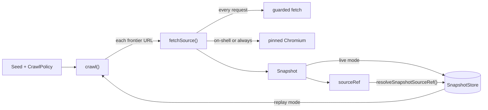

# Concepts

forage is a crawler for URLs you do not control, whose pages become evidence
that a person reviews and cites. It has five building blocks: the crawl
frontier, guarded egress, single-page fetch, snapshots with their stores, and
provenance references. This page explains each one and how they fit together.
The [design notes](../DESIGN.md) explain why they are built this way.

## The crawl frontier

`crawl(seed, policy)` is the package's main entry point. It runs a bounded,
breadth-first frontier, one URL at a time:

1. It validates the seed and policy. A bad value throws
   `InvalidCrawlConfigError`, the only error `crawl()` throws.
2. With `discovery: "sitemap"` or `"both"`, it reads the seed origin's
   `robots.txt` `Sitemap:` directives (or `/sitemap.xml` when there are none)
   and queues each same-host page URL at depth 1.
3. It takes the next URL from the queue and acquires it with `fetchSource()`
   (live) or from the store (replay).
4. If the page is HTML, its depth is below `maxDepth`, and link discovery is on
   (`"links"` or `"both"`), it extracts `<a href>` links and queues each new URL
   at the next depth. With `sameHost` (the default), only links on the seed's
   origin are queued.
5. It stops when the queue is empty or after `maxPages` acquisition attempts.
   Failed attempts count toward `maxPages`.

The result is a `CrawlManifest`: the pages, a `truncated` flag that is true
when URLs were still queued at the cap, crawl-level `warnings`, and, when
`discovery` is `"sitemap"` or `"both"`, `sitemap.documentsRead` and
`sitemap.urlsDiscovered`.

### Never-throws

Operational failures never abort a crawl. A denied address, a robots refusal,
a timeout, an HTTP error, a failed `store.put`, or a parse problem becomes a
warning prefixed with the page's depth and URL, and the crawl moves on. A
crawl whose seed is refused returns an empty `pages` list and a warning that
says why, unless sitemap discovery found other pages to fetch.

### Deferred seams

Two policy fields are accepted but not yet acted on. `shouldFollow` (a frontier
scorer) and `politeness.concurrency` other than 1 each add a warning, and the
crawl uses its deterministic host and depth rules with a sequential frontier.
forage ships no AI; `shouldFollow` is where a consumer could plug scoring in.

## Guarded egress

Every request forage makes goes through a guarded `fetch`. The guard is on by
default; `egress: { guarded: false }` turns it off for plain HTTP requests, but
browser rendering is always guarded. For each
request, and again for each redirect hop, it:

- accepts only `http:` and `https:` URLs without credentials, on the default
  port (80 or 443);
- refuses `localhost`, `*.localhost`, and cloud metadata hostnames such as
  `metadata.google.internal`;
- resolves the hostname once and requires **every** DNS answer to be a public
  address, refusing private, loopback, link-local, carrier-grade NAT,
  multicast, documentation, and reserved ranges, and IPv6 forms that embed a
  refused IPv4 address;
- connects to the one validated IP while keeping the hostname for the `Host`
  header and TLS SNI, so a second DNS answer cannot rebind the connection.

When the guard follows redirects itself, it refuses a redirect to another
origin, or from `https:` to `http:`. A refusal is an `EgressUrlPolicyError`
with a code such as `DENIED_ADDRESS` or `INVALID_PORT`. Inside `crawl()` and
`fetchSource()` it is reported as an `egress-denied` error.

The same guard is exported on its own from `@kontourai/forage/egress`, so a
consumer can protect any `fetch`-shaped call. See
[the egress reference](reference.md#kontouraiforageegress).

## Single-page fetch

`fetchSource(config, options)` acquires one URL. `crawl()` calls it for every
frontier page, and it is exported from `@kontourai/forage/fetch` for callers
that need one page without a frontier. For each request it:

- checks `robots.txt` for the origin (cached per origin), unless
  `respectRobots` is `false`;
- waits so requests to one origin are at least `minDelayMs` apart (1,000 ms by
  default);
- retries timeouts, network errors, HTTP 429, and HTTP 5xx with jittered
  backoff (2 retries by default, at most 5);
- follows up to 5 redirects itself, sending each hop through the guard again
  and re-checking robots.txt (except when rendering). A redirect to another
  host, or from `https:` to `http:`, fails with a `network` error;
- sends `If-None-Match` and `If-Modified-Since` from the source's latest
  stored snapshot, when a store is supplied, `revalidate` is not `false`, and
  that snapshot's URL is the one being requested. A `304 Not Modified` returns that stored snapshot with
  `notModified: true`.

It returns `{ snapshot?, error?, warnings? }`. It never throws for an
operational failure, and it never writes to the store.

### Adaptive rendering

`render: "on-shell"` renders a page in a browser only when the plain HTML
response looks like a JavaScript shell: very little visible text, plus either
a very low text-to-markup ratio or an app bootstrap marker such as a
`<script>` tag or `
`. `render: "always"` (or `Seed.render: true`
for the seed page) renders every matching page.

The browser is pinned too. forage resolves the hostname through the guard
once, launches a dedicated headless Chromium whose host resolver maps that
hostname to the validated IP, blocks service workers, and aborts every request
to any other hostname. Rendering needs the optional `playwright` peer. If it is
missing or rendering fails, the plain snapshot is kept and a warning says why.
A rendered snapshot has `rendered: true`, and its body is the serialized DOM.

## Snapshots

A `Snapshot` is the durable record of one acquisition: `sourceId`, final
`url`, `status`, `fetchedAt`, `headers`, any same-host `redirects`, the
`body`, and `bodyHash`.

- **Binary bodies** keep the raw bytes in `body`.
- **Text bodies** keep the exact bytes received in `bytes` and the lower-cased
  `charset` from `Content-Type` in `declaredCharset`. `body` is the text
  decoded from those bytes by `decodeTextBody()`, using UTF-8 when no charset
  is declared.
- **Rendered bodies** have no wire bytes; `body` is the HTML string.

`bodyHash` is a SHA-256 hex digest. `snapshotHashBasis(snapshot)` reports what
it covers: `"bytes"` for binary bodies and new text captures, or
`"decoded-utf8"` for rendered snapshots and text snapshots written by releases
before 1.0.0.

## Snapshot stores

A `SnapshotStore` persists and replays snapshots per `sourceId`, with
`put`, `latest`, `get`, and `list`, and optionally `findExact` and `prune`. In
live mode with a store, `crawl()` puts every acquired page. In replay mode it
serves each page from `store.latest()` and makes no network request. With
sitemap discovery, the robots.txt and sitemap documents are stored and
replayed the same way, under their own source ids.

forage ships two implementations:

- `createInMemorySnapshotStore()`, for tests and short-lived processes.
- `createFilesystemSnapshotStore({ root, maxHistoryFiles? })`, which keeps
  immutable JSON records per source. It is bounded (at most 10,000 records per
  source, lowered with `maxHistoryFiles`, and 96 MiB per record), fail-closed on corrupt records, safe for
  several writer processes through a per-source lock, and never deletes
  anything unless you call `prune()`. It can also produce a
  [verified source-head witness](reference.md#verified-source-head-witnesses).

## Provenance references

Every crawled page has a `sourceRef`, a string of the form
`forage-snapshot:<sourceId>?url=…&sha256=…&fetchedAt=…&snapshotSha256=…`. It
commits to the body hash and to a digest of the canonical replay metadata
(status, headers, redirects, render state, and body encoding), so a review
tool can cite it and later prove which bytes it meant.

`resolveSnapshotSourceRef(store, ref)` parses a canonical reference, looks it
up with the store's `findExact`, and checks the stored snapshot against every
committed field. It returns `{ ok: true, snapshot, integrity }` or
`{ ok: false, error }`, where `error.kind` distinguishes an invalid reference,
a missing snapshot, a mismatch, a corrupt store, and a store that could not be
read. It never fetches and never accepts a hash prefix.

## Where forage sits

forage knows nothing about extraction. In the Kontour stack it is the bottom
layer:

- **traverse** (`@kontourai/traverse`) does schema-directed extraction and
  composes forage's crawl and guarded egress in its `/fetch` subpath.
  `@kontourai/forage/fetch` keeps the same import names as
  `@kontourai/traverse/fetch`, so a caller can switch between them.
- **lookout** is the consumer the `@kontourai/forage/fetch` subpath was
  exported for (its drift checks), and it uses the guarded single-URL egress
  in production.
- **campfit** is the application on top. Its move from its own egress and
  render code onto forage is still pending.
